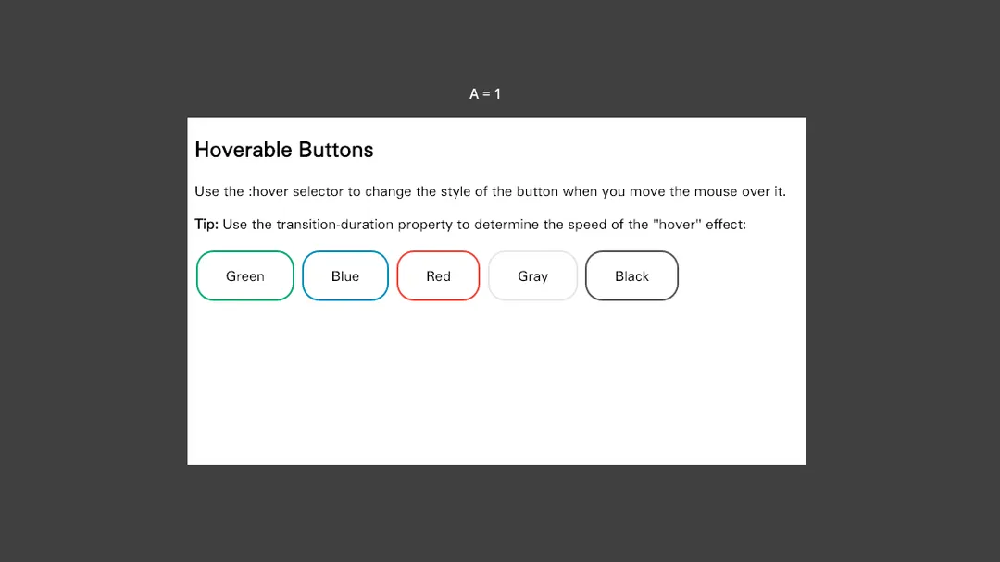
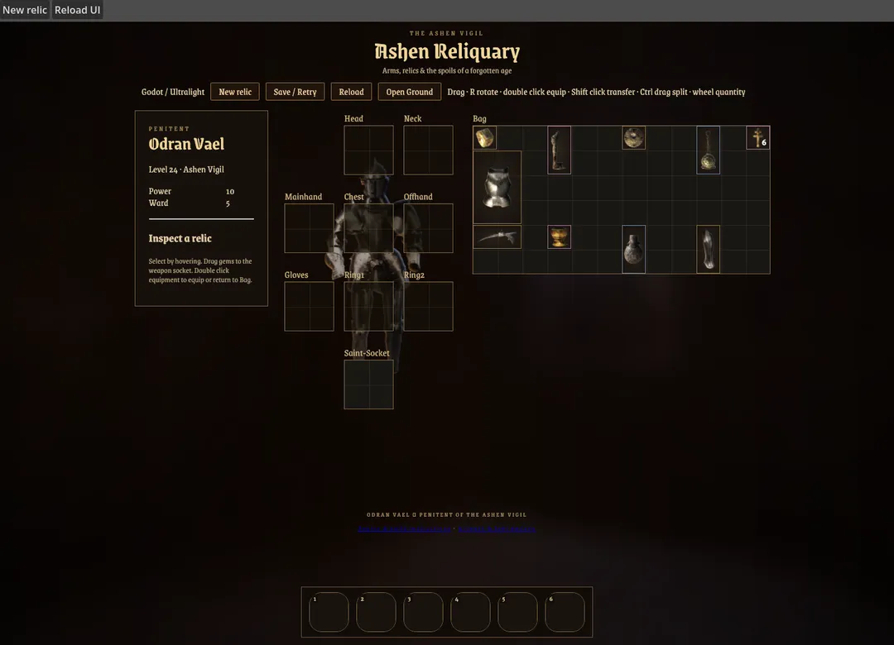
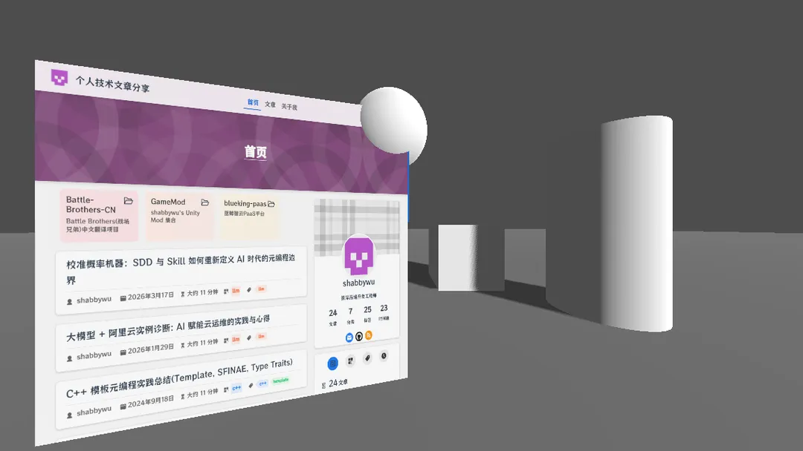
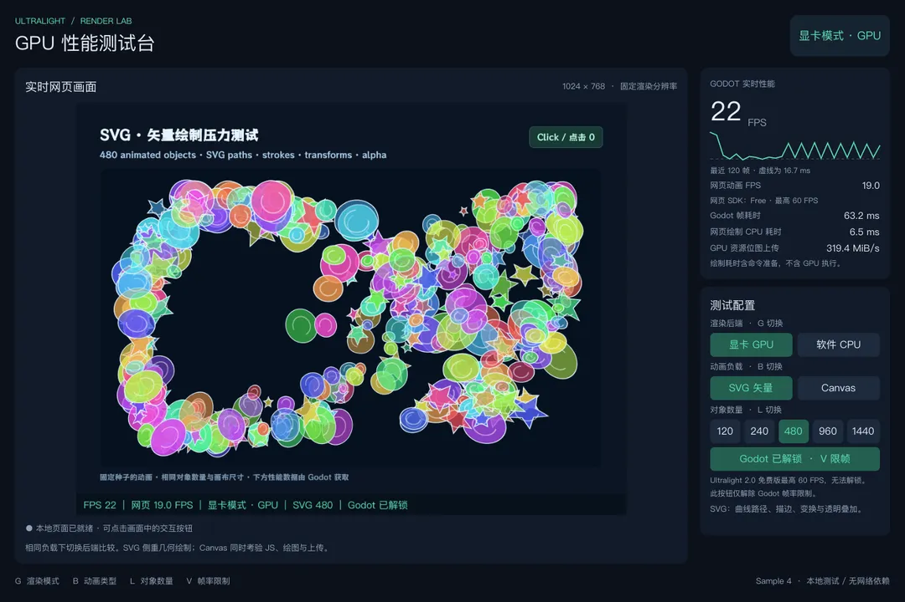

# ultralight-godot

**使用 HTML、CSS 和 JavaScript 构建 Godot 界面。**

[English](README.md) | 简体中文

ultralight-godot 通过 GDExtension 将 [Ultralight](https://ultralig.ht/) 集成到 Godot。
使用 `UltralightView` 显示网页内容，通过 GDScript 或 C# 与 JavaScript 交互，
并在 2D、3D 场景中使用支持透明背景的网页界面。


[安装](#安装) · [示例](#示例) · [JavaScript 绑定](#javascript-绑定) · [自动发布](#自动发布)

## 功能

- 渲染 HTML，使用 CSS 编写界面样式，支持透明背景。
- 在 GDScript 或 C# 中执行 JavaScript、调用 JavaScript 函数。
- 向 JavaScript 暴露 Godot 对象和回调。
- 支持鼠标移动、点击、滚轮和键盘输入。
- 使用配套 mini-browser 远程检查器调试网页内容。
- 在 Godot 编辑器中直接查阅类文档。

## 环境要求

| 组件 | 支持版本 / 平台 |
| --- | --- |
| Godot | 4.3 及以上（扩展声明的最低兼容版本） |
| Ultralight SDK | 当前源码要求 **2.0.0-beta.2** |
| Windows | x86_64 |
| Linux | x86_64 |
| macOS | arm64（Apple Silicon） |

当前流水线生成的发布包已包含匹配的 SDK 运行库。历史版本可能使用不同的 SDK，
请查阅对应 Release 的说明，确保扩展与 SDK 版本匹配。

**Ultralight Free 版本将 View 动画与重绘限制为 60 FPS。**
关闭 Godot 帧率上限、关闭 VSync 或将 `max_render_fps` 设为 `0`，
均无法解除 SDK 版本本身的限制。

## 安装

1. 打开 [Releases 页面](https://github.com/shabbywu/ultralight-godot/releases)。
2. 下载目标版本的 `ultralight-view.<tag>.gdextension.7z`。
3. 将压缩包解压到 Godot 项目根目录。当前流水线生成的安装包目录结构如下：

   ```text
   your-project/
   ├── project.godot
   └── addons/
       └── ultralight-view/
           ├── ultralight-view.gdextension
           └── bin/
               ├── win64/
               ├── x11/
               └── macos-arm64/
   ```

4. 在 Godot 中打开项目，添加 `UltralightView` 节点。
5. 参考[示例](#示例)加载网页内容并与游戏逻辑连接。

合并安装包包含三个平台的 Debug、Release 扩展及匹配的 Ultralight 运行库，
使用时无需单独下载 SDK。升级时请替换原有的 `addons/ultralight-view` 目录，避免混用版本。

如需使用远程检查器，请从同一个 Release 下载对应平台的 `mini-browser` 压缩包。
每个浏览器安装包也已包含所需的 SDK 运行库。

## 示例

| 示例 | 演示内容 |
| --- | --- |
| [加载 HTML 并绑定 C# 回调](samples/Sample%201%20-%20Load%20Html%20And%20Bind%20CSharp%20Callback) | 加载网页内容，通过 JavaScript 调用 C# |
| [Ashen Reliquary 背包](samples/Sample%202%20-%20Inventory%20System) | 使用网页技术构建背包界面 |
| [3D 界面](samples/Sample%203%20-%203D) | 在 3D 场景中集成 `UltralightView` |
| [GPU / CPU 对比](samples/Sample%204%20-%20GPU) | Canvas/SVG 动画、FPS 和渲染耗时 |

以下为实际 Godot 运行画面的循环 WebP 录制，点击示例名称查看使用说明。

### 1 · HTML 与 C# 回调



### 2 · Ashen Reliquary 背包



### 3 · 3D 网页界面



### 4 · GPU / CPU 对比



## JavaScript 绑定

通过默认兼容模式，将 Godot 对象暴露给 JavaScript：

```gdscript
view.bind_object("probe", probe)
```

将第三个参数设为 `true`，为当前绑定启用成员查询：

```gdscript
view.bind_object("probe", probe, true)
view.execute_script("Object.keys(probe)")
view.execute_script("'label' in probe && Reflect.has(probe, 'echo')")
```

成员查询模式的行为如下：

- `Object.keys()` 枚举 Godot 属性元数据；方法可以查询，但不会出现在枚举结果中。
- 排除分类、分组、子分组及内部条目。
- 查询使用当前元数据，不读取属性值，也不调用 getter。缺失成员遵循 JavaScript 的常规查找规则。
- Godot 对象释放后，其成员不再出现在查询和枚举结果中。
- **C# 属性需要添加 `[Export]`。** 默认兼容模式仍可访问普通 public C# 属性。

查询选项只影响当前显式绑定的对象，回调返回的对象及嵌套容器中的对象仍使用兼容模式。
每次加载新文档时都需要重新安装绑定，通常在 `on_window_object_ready` 中处理。
文档被替换或 View 被销毁后，返回的 JavaScript Callable 和尚未完成的 Promise 会失效。

### 类型转换与实现细节

扩展使用 ulbind17 处理带检查的 JavaScript 操作、句柄持有、Promise 观察和遍历保护。
Godot 负责 Variant 转换、Callable 桥接、信号、View 生命周期、输入和纹理上传。

- JavaScript 对象转换为 `Dictionary` 时，包含原型上的可枚举属性。
- `null` 和 `undefined` 转换为 Nil，数字转换为 double。
- 容器转换会拒绝循环引用及超过 64 层的嵌套。
- Godot String 转换会截断内嵌 NUL 字符，Dictionary 的键也受影响。
  ulbind17 独立的 JSC 字符串工具可保留 NUL，但当前适配层不保留。

资源文件系统使用 ulbind17 的嵌入式资源覆盖层，并以 Godot 文件系统作为后备。
构建时会将三个核心 SDK 运行库（`Ultralight`、`UltralightCore`、`WebCore`）
复制到扩展所在目录；mini-browser 还会附带 `AppCore`。
从源码构建时，可设置 `COPY_ULTRALIGHT_BINARY=OFF` 关闭复制。

## 自动发布

发布 GitHub Release（包括预发布版本）后，会针对该 Release 的 tag 启动两个独立的工作流：

| 工作流 | 上传的附件 |
| --- | --- |
| [Build GDExtension](.github/workflows/build-gdextension.yaml) | `ultralight-view.<tag>.gdextension.7z`，包含所有支持平台的扩展和 SDK 运行库 |
| [Build Mini Browser](.github/workflows/build-mini-browser.yaml) | `mini-browser.linux.7z`、`mini-browser.win64.7z`、`mini-browser.macos-arm64.7z` |

1. 提交 workflow 修改，确保版本 tag 包含这些修改。
2. 为该 tag 创建 Release，并点击 **Publish release**。仅保存草稿不会触发构建。
3. 每个工作流分别构建 Windows x86_64、Linux x86_64 和 macOS arm64。
4. 各自的构建及已有验证步骤全部成功后，打包并将附件上传到该 Release。
   一个工作流失败不会阻止另一个工作流上传。

打包时会检查扩展、可执行文件及 SDK 运行库是否齐全，缺失则失败。
上传使用内置的 `GITHUB_TOKEN`，无需额外配置 secret。

如需重新构建已有 Release 的附件，可在 Actions 中手动运行对应工作流，
将 `release_tag` 填为目标 tag。工作流会检出该 tag，覆盖同名附件，并保留 Release 描述。
留空 `release_tag` 则只生成可下载的 Actions 构建产物，不上传到 Release。
